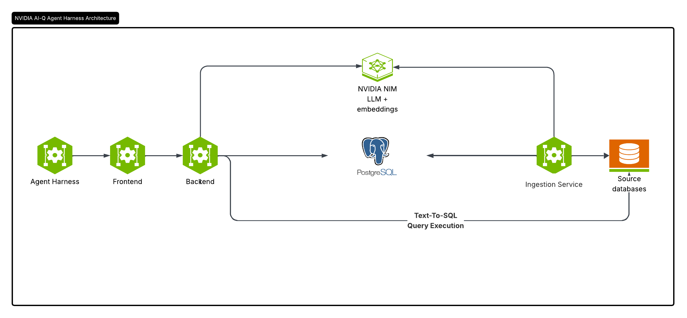
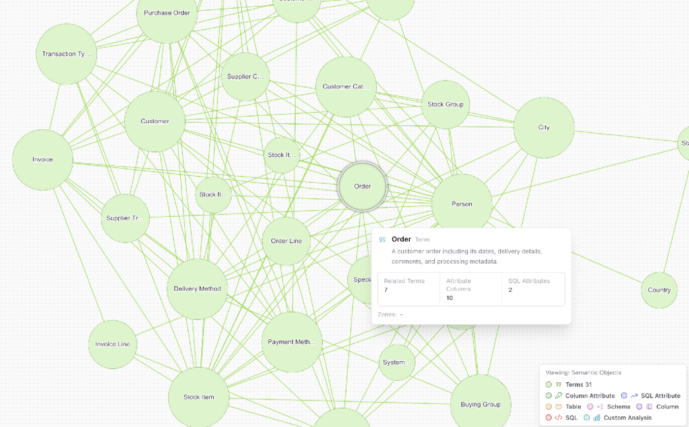
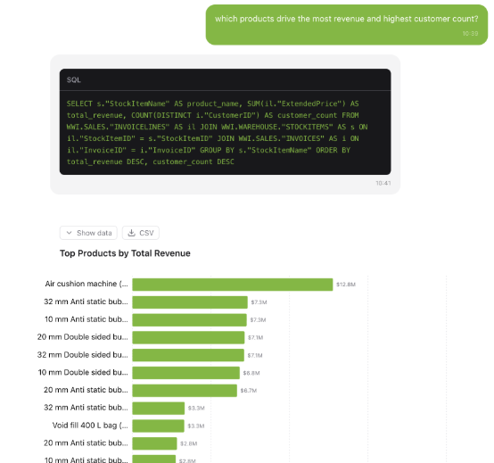

<!--
SPDX-FileCopyrightText: Copyright (c) 2026, NVIDIA CORPORATION & AFFILIATES.
All rights reserved.
SPDX-License-Identifier: Apache-2.0
-->

# All-Ontology

An agent can find a table and write SQL. What it cannot do on its own is say whether `revenue` means gross or net, whether the column it just joined on is allowed to leave the warehouse, or which of three systems owns the definition. A fast answer that is wrong is worse than a slow one, so agentic analytics needs a context layer, not another prompt.

**All-Ontology** is that layer, as an open-source product rather than a paper design. Point it at a warehouse, an uploaded spreadsheet, or a REST endpoint and it builds a profiled catalog of the estate; layer a governed semantic model on top (glossary terms, metric SQL, semantic foreign keys, bridge tables); then answer questions in natural language with SQL that has been checked before it runs. The catalog, the ontology, the ER diagrams and the conversation history all live in one Postgres — one backup, one permission model, one place to audit.

People use it through a web UI; agents use it through a REST API or the bundled read-only MCP server.

<p>

</p>

## What it does

| Job | What ships in this repository |
| --- | --- |
| **Connect** | Eleven SQL engines (PostgreSQL, SQL Server, MySQL, Snowflake, Databricks, Trino, ClickHouse, Kyuubi, HeavyDB, DuckDB, SQLite), uploaded Excel / CSV / Parquet files, and plain REST endpoints. Credentials come from the environment or HashiCorp Vault. |
| **Understand** | A profiled catalog — schemas, tables, columns, primary and foreign keys, uniqueness, nullability, row counts, distinct values — kept fresh by incremental re-ingest and scheduled refresh, with PII detection over what it finds. |
| **Define** | Glossary terms, column aliases, certified metric SQL, semantic foreign keys and bridge tables, compiled into the retrieval context and versioned so a definition change is reviewable. Model YAML can be imported and exported to work alongside models you already own. |
| **Ask** | Natural-language to SQL over the semantic layer, with probe-based validation (literal checks, join-path checks, row caps) before a result is returned, plus the SQL, charts and saved analyses behind each answer. |
| **Review** | A per-zone ER canvas that reconciles itself with the catalog: drag tables, draw relationships, annotate columns and tables, keep versions and templates, import/export DBML, SQL or JSON, export SVG/PNG, and ask an assistant whose proposed edits are validated before they land. |
| **Parse** | PDFs and images turned into Markdown or JSON with tables, formulas, figures and chemical structures extracted, as asynchronous jobs the UI polls. |
| **Know** | A knowledge ontology built from parsed documents: concepts, relations, actions, risks, concept groups, grounded facts and page-level evidence, reviewable and exportable as a BKN package. Its graph uses the same Sigma canvas as Exploration, and concepts link to terms or tables to connect both ontologies. |
| **Govern** | Zones scope data per team; tags, owners, certification and saved-search rules label what they match; Better Auth provides SSO, invitations, API tokens and role-based access. |
| **Serve** | A React web UI (English and 中文), a REST API with OpenAPI documents, and a read-only MCP server (`all-ontology-mcp`) with three agent skills for setup, modelling and querying. |

The semantic compiler groups copies of one schema into **term families**
(`OLD_ROOMS` / `NEW_ROOMS`), verifies inferred foreign keys against each
column's lowest distinct values, attaches suspected FK columns that resolved
to nothing, and fills in a business description for any ColumnAttribute that
still lacks one.
Columns tagged **PII** are left out of value sampling, and stored values are
withheld when the tag appears. See
[`docs/architecture/semantic-quality-1.3.md`](./docs/architecture/semantic-quality-1.3.md).

Four properties are worth calling out, because they are what the code is built around:

- **One database, not a sidecar.** The catalog and the ontology are tables in the same Postgres as the data they describe (Alembic owns the catalog schema, Prisma owns identity), so a backup or a permission change covers both.
- **Validation before generation is trusted.** Generated SQL is probed against real literals and join paths, and row limits are applied per dialect — the answer ships with evidence, not just a query.
- **The diagram belongs to the browser.** The ER canvas is client-owned and reconciled server-side, which keeps multi-tab editing honest and makes a whole assistant batch a single undo step.
- **Scoping is a read-time filter.** A zone is applied to every catalog, search and exploration query, so the same instance can serve teams that must not see each other's tables.

## Benchmarks

To run a text-to-SQL benchmark such as BIRD, refer to the
[ontology SQL evaluation repository](https://github.com/NVIDIA/ontology-sql-eval/).

> **Licensing & contributions.** All-Ontology is distributed under the
> [Apache License 2.0](./LICENSE). Third-party open-source components
> bundled, linked, or otherwise used by this project are listed in
> [`THIRD_PARTY_NOTICES.md`](./THIRD_PARTY_NOTICES.md). **This project
> is currently not accepting external contributions.**

## Software Components

| Component           | Technology                                                             | Role                                       | Default port |
| ------------------- | ---------------------------------------------------------------------- | ------------------------------------------ | ------------ |
| Frontend            | Next.js 16 (React 19, TypeScript, Tailwind CSS 4), Better Auth, Prisma | Web UI, authentication, API gateway        | 3010         |
| Backend             | FastAPI (Python 3.12+), LangChain                                      | Chat / NL-to-SQL, catalog, ontology, ER canvas, document parsing | 3001 |
| Ingestion worker    | FastAPI (Python 3.12+)                                                 | Ingests tabular data and writes embeddings | 3002         |
| Postgres + pgvector | Relational Database                                                    | App metadata, the catalog and ontology, vector store | 5432 |
| HashiCorp Vault     | Optional                                                               | Secure storage of connection credentials   | —            |

`docker compose` and the Helm chart publish the frontend on **3010**; the native
scripts in `dev_tools/` bind **3000**. `APP_URL` has to name the port you
actually open, or sign-in redirects will point at the wrong origin.

### NVIDIA NIM

All-Ontology uses NVIDIA NIM endpoints for inference — either the hosted
[NVIDIA API catalog](https://build.nvidia.com) (`integrate.api.nvidia.com`) or
self-hosted NIMs. The defaults in `.env.example` are:

- **LLM:** `nvidia/nemotron-3.5-lightning-30b-a3b`
- **Embeddings:** `nvidia/nemotron-3.5-embed-1b`
- **Reranking:** `nvidia/nemotron-3.5-rerank-8b`

The endpoints and models are configured via the `DEFAULT_MODELS_ENDPOINT`, `DEFAULT_MODELS_MODEL`,
`EMBED_ENDPOINT`, and `EMBED_MODEL` environment variables and require a
`DEFAULT_MODELS_API_KEY`.

#### Model triplets

Each model role is configured by a **triplet** of environment variables —
`<PREFIX>_ENDPOINT` (URL), `<PREFIX>_API_KEY`, and `<PREFIX>_MODEL`:

| Prefix           | Role                                                        |
| ---------------- | ----------------------------------------------------------- |
| `DEFAULT_MODELS` | Shared default; every field below falls back to it.         |
| `REASONING`      | Main chat / NL-to-SQL model.                                |
| `NON_REASONING`  | Lighter model used for entity extraction.                   |
| `EMBED`          | Text-embedding model (must match between ingest and query). |
| `RERANK`         | Reranker used by the retrieval flow.                        |

You can set a full triplet, only some of its fields, or none at all — any field
left unset falls back to the matching `DEFAULT_MODELS_<FIELD>`. So the simplest
setup is to fill in `DEFAULT_MODELS_*` and override per-triplet fields only where
they differ (e.g. `EMBED_MODEL`, `NON_REASONING_MODEL`). `*_API_KEY` also falls
back to the legacy `NVIDIA_API_KEY` for backward compatibility.

In the UI, **Settings → LLM Settings** can persist the conversational Base URL,
API key, and model in the instance configuration database. Those values override
`REASONING_*` and `NON_REASONING_*` on the next service start; embedding and
reranking keep their environment configuration. The API key is never returned
to the browser.

## Quickstart

This runs All-Ontology with Docker Compose against Wide World Importers,
Microsoft's sample sales database. You need Docker with Compose v2,
[uv](https://docs.astral.sh/uv/), and an NVIDIA API key (`nvapi-...`) from
[build.nvidia.com](https://build.nvidia.com).

1. Clone the repository and create `.env`:

   ```bash
   git clone https://github.com/NVIDIA/all-ontology.git && cd all-ontology
   cp .env.example .env
   ```

   Then set these values in `.env`:

   ```dotenv
   DEFAULT_MODELS_API_KEY=nvapi-...
   AUTH_SECRET=<a long random string, e.g. from openssl rand -base64 32>
   APP_URL=http://localhost:3010
   POSTGRES_PASSWORD=<a new password>
   CONNECTION_STRINGS=postgresql://postgres:<the same password>@postgres:5432/wideworldimporters
   ALL_ONTOLOGY_ADMIN_PASSWORD=<a new password>
   PGADMIN_PASSWORD=<a new password>
   ```

   Compose publishes Postgres, pgAdmin, and the web app on the host, so replace
   each default password before you start it. `.env.example` also sets an API
   key per model role: replace each `nvapi-your-api-key-here` with your key, or
   delete those lines so they fall back to `DEFAULT_MODELS_API_KEY`.

2. Start Postgres and load the sample database. The seed script lives in
   auto-ontology-eval; pass it the Postgres password you set:

   ```bash
   docker compose up -d --wait postgres
   git clone https://github.com/NVIDIA/auto-ontology-eval.git ../auto-ontology-eval
   (cd ../auto-ontology-eval && uv sync && cp .env.example .env && \
     POSTGRES_PASSWORD='<the same password>' \
     uv run python scripts/seed/seed_wwi.py --database-name wideworldimporters --drop)
   ```

3. Build and start the rest of the stack:

   ```bash
   docker compose up -d --build
   ```

4. Open <http://localhost:3010> and sign in with `ALL_ONTOLOGY_ADMIN_EMAIL` and
   `ALL_ONTOLOGY_ADMIN_PASSWORD` from `.env`. Go to **Settings → Semantic
   Compilation** and turn it on. Ingestion runs at startup; compilation starts
   immediately and reports **Semantic compilation is ready** when it finishes.

5. Ask a question in **Chat**:

   > What was revenue for the USB food flash drive - sushi roll in Pennsylvania
   > in June 2015?

   The agent resolves *revenue*, *product*, and *state* to terms in the
   ontology, follows their relationships to the joins it needs, and runs the
   query. The answer comes back with its SQL and the steps that produced it,
   so you can check the result against the source:

   ```text
   Answer:  Revenue for USB food flash drive - sushi roll in Pennsylvania in
            June 2015 was $588.80, from 3 invoice lines.

   SQL:     SELECT SUM(il.extendedprice) AS revenue, COUNT(*) AS invoice_lines
            FROM sales.invoicelines il
            JOIN sales.invoices i             ON il.invoiceid = i.invoiceid
            JOIN warehouse.stockitems si      ON il.stockitemid = si.stockitemid
            JOIN sales.customers c            ON i.customerid = c.customerid
            JOIN application.cities ct        ON c.deliverycityid = ct.cityid
            JOIN application.stateprovinces sp ON ct.stateprovinceid = sp.stateprovinceid
            WHERE si.stockitemname = 'USB food flash drive - sushi roll'
              AND sp.stateprovincename = 'Pennsylvania'
              AND i.invoicedate >= '2015-06-01' AND i.invoicedate < '2015-07-01'

   Steps:   Resolved terms: Invoice Line (revenue), Stock Item, State Province, Invoice
            Joined: invoice line -> invoice -> customer -> city -> state province
            Validated the filter values against the data, then executed
   ```

6. Ask something the data can't answer. Wide World Importers has no
   advertising data, so a question about ad spend has nothing to resolve
   against. An agent connected through [MCP](#mcp-server) checks answerability
   first and asks you to clarify:

   ```text
   You:    What was return on ad spend for the sushi roll flash drive in June 2015?
   Agent:  check_answerable -> coverage 0.5; no term covers "ad spend"
   Agent:  I can find revenue for that product, but this data has no
           advertising spend, so I can't compute return on ad spend. Do you
           want June 2015 revenue instead, or is ad spend tracked in another
           source I should connect?
   ```

If the UI loads without its left navigation after a restart, the browser is
holding a stale session cookie. Clear site data for `localhost:3010` and sign in
again. For other setup failures, see the
[setup skill's troubleshooting guide](./skills/nvidia-ontology-setup/references/troubleshooting.md).

## How it works

<p>

</p>

All-Ontology works in three stages: it generates an ontology, people certify
it, and the agent answers questions from it.

The ontology holds three kinds of definition:

- **Terms.** Business concepts such as *Customer* or *Invoice Line*, each with a
  description and synonyms, mapped to the columns that hold them.
- **SQL attributes.** Reviewed SQL expressions under a term, such as a margin or
  a rolling total. The agent reuses them, so answers compute each measure the
  same way.
- **Relationships.** How tables join, including bridge tables, inferred from
  keys and from the data.

**Generate.** The ingestion service builds a first draft from the source
databases:

1. Read sources: extract schemas, profile columns, and sample values into the
   catalog.
2. Name entities: extract terms table by table and map each to columns.
3. Resolve relationships: infer joins between tables and bridge tables, and
   suggest SQL attributes from query history.
4. Write the ontology: store terms, relationships, and SQL attributes in
   Postgres, with embeddings in pgvector for retrieval.

The result is a semantic graph you can explore in the UI. In this example, one
compilation of Wide World Importers produced 31 terms; selecting **Order** shows
its description, related terms, mapped columns, and SQL attributes:

<p>

</p>

**Certify.** People make the draft trustworthy:

1. Test with real questions in Chat, or with `check_answerable` and
   `ask_question` over MCP.
2. Refine terms, descriptions, and SQL attributes in the UI or through the API.
3. Certify names, descriptions, and SQL attributes once they're correct.

**Answer.** For each question, the agent:

1. Classifies the intent and extracts the entities the question names.
2. Retrieves candidate terms, columns, and SQL attributes by embedding search.
3. Writes SQL from those candidates.
4. Checks the filter values and the query against the database, repairing the
   SQL when a check fails.
5. Runs the query and returns the answer with its SQL and the steps it took.

When the candidates can't support a query, the agent reports that the question
can't be answered from this data. Predictive questions go to KumoRFM when it's
configured (see [Predictions](#predictions)).

In Chat, each answer shows its SQL, and you can view the rows, download them as
CSV, or read them as a chart:

<p>

</p>

All-Ontology is compatible with [Apache Ossie](https://ossie.apache.org/), the
open standard for exchanging semantic models. Ossie includes a
[converter for All-Ontology](https://github.com/apache/ossie-converters/tree/main/nvidia),
which All-Ontology uses to import and export model definitions as Ossie YAML.
Use **Settings → Import / Export**, or `POST /api/model/import` and
`POST /api/model/export`.

| Component           | Technology                        | Role                                       | Port |
| ------------------- | --------------------------------- | ------------------------------------------ | ---- |
| Frontend            | Next.js, Better Auth, Prisma      | Web UI, authentication, public API gateway | 3010 |
| Backend             | FastAPI (Python 3.12+), LangChain | Text-to-SQL agent, catalog, ontology APIs  | 3001 |
| Ingestion service   | FastAPI (Python 3.12+)            | Ingestion and semantic compilation         | 3002 |
| MCP server          | FastMCP                           | Read-only agent tools over the public API  | 3003 |
| Postgres + pgvector | PostgreSQL 17                     | Catalog, ontology, app data, vector store  | 5432 |
| HashiCorp Vault     | Optional                          | Connection credential storage              | n/a  |

Keep ports 3001 and 3002 on a private network. FastAPI trusts the user identity
the frontend forwards in the `x-all-ontology-user-id` header, and the ingestion
service's endpoints (ingest, delete, reset, compile) have no authentication of
their own. Clients go through the web app on port 3010.

## Use it from your agent

### MCP server

The [MCP](https://modelcontextprotocol.io) server gives any MCP client read-only
tools over the ontology. Each user signs in through All-Ontology, and every
call runs with that user's permissions.

| Job           | Tools                                                         |
| ------------- | ------------------------------------------------------------- |
| Readiness     | `check_readiness`: can this deployment answer anything at all |
| Terms         | `search_terms`, `get_term`, `get_term_columns`, `get_term_sql_attributes`, `get_sql_attribute`, `describe_table` |
| Answerability | `check_answerable`: does the ontology cover this question     |
| Questions     | `ask_question`: the answer, the SQL, and the rows             |

Run the server against your deployment:

```bash
ALL_ONTOLOGY_API_URL=http://localhost:3010 \
  uvx --from "git+https://github.com/NVIDIA/all-ontology.git#subdirectory=mcp" all-ontology-mcp
```

Cursor (`~/.cursor/mcp.json`):

```json
{
  "mcpServers": {
    "all-ontology": { "url": "http://localhost:3003/mcp" }
  }
}
```

Claude Desktop (`claude_desktop_config.json`), bridged with
[`mcp-remote`](https://www.npmjs.com/package/mcp-remote):

```json
{
  "mcpServers": {
    "all-ontology": {
      "command": "npx",
      "args": ["mcp-remote", "http://localhost:3003/mcp"]
    }
  }
}
```

Restart the client after editing its config, then sign in when it prompts.
Sign-in, configuration, and troubleshooting are in [docs/mcp.md](./docs/mcp.md).

### Agent skills

Three skills teach a coding agent to work with All-Ontology. Start at
[AGENTS.md](./AGENTS.md).

| Skill                                                                | Covers                                               |
| -------------------------------------------------------------------- | ---------------------------------------------------- |
| [`nvidia-ontology-setup`](./skills/nvidia-ontology-setup/)           | Install, connect sources, compile, prove readiness   |
| [`nvidia-ontology-management`](./skills/nvidia-ontology-management/) | Inspect, model, certify, import/export, and publish  |
| [`nvidia-ontology-query`](./skills/nvidia-ontology-query/)           | Ask questions and validate the SQL, rows, and answer |

### REST API

Ask a question with `POST /api/chat/completions` on the web app's origin. Mint
an API token under the user menu → **API Tokens**. The response is a
server-sent event stream: a `result` event carries the answer, and
`data: [DONE]` ends the stream.

```bash
curl -N http://localhost:3010/api/chat/completions \
  -H "x-api-key: $ALL_ONTOLOGY_API_TOKEN" \
  -H "Content-Type: application/json" \
  -d '{"question": "How many orders shipped last week?"}'
```

```python
import json
import os

import requests

response = requests.post(
    "http://localhost:3010/api/chat/completions",
    headers={"x-api-key": os.environ["ALL_ONTOLOGY_API_TOKEN"]},
    json={"question": "How many orders shipped last week?"},
    stream=True,
    timeout=900,
)
response.raise_for_status()

for line in response.iter_lines(decode_unicode=True):
    if not line or not line.startswith("data:"):
        continue
    payload = line.removeprefix("data:").strip()
    if payload == "[DONE]":
        break
    event = json.loads(payload)
    if event["type"] == "result":
        print(event["answer"]["response"])
        print(event["answer"]["sql_code"])
    elif event["type"] == "error":
        raise RuntimeError(event["message"])
```

Event types, multi-turn conversations, and the gateway trust boundary are in
[docs/conversation-api.md](./docs/conversation-api.md). Every other operation is
in the [OpenAPI spec](./docs/openapi/all-ontology-api.json).

## Connectors, models, and predictions

### Sources

All-Ontology connects to eleven engines:

- PostgreSQL
- MySQL
- Microsoft SQL Server
- Databricks
- Snowflake
- ClickHouse
- Trino
- Apache Kyuubi
- HeavyDB
- DuckDB
- SQLite

Add connections under **Settings → Connections**, or list them in
`CONNECTION_STRINGS`. DuckDB and SQLite are connection-string only. See
[docs/connections.md](./docs/connections.md) for URL schemes, scoping, and
credential storage.

Files can be used as a source too: upload a CSV, TSV, PCL, XLSX, XLS, or
Parquet file in the same wizard, choose which row holds the column names,
rename the columns (and, for delimited text, pick the separator), and it
becomes a DuckDB-backed table in the catalog.

REST endpoints work the same way: point a connection at a JSON or CSV URL
(with headers, params, body, and bearer/basic auth), rename its fields, and
refresh the snapshot whenever the source changes.

### Models

All-Ontology uses four model roles. With an `nvapi-` key, each defaults to an
NVIDIA NIM on [build.nvidia.com](https://build.nvidia.com):

| Role            | Default model                           | What it does                                                                                                                   |
| --------------- | --------------------------------------- | ------------------------------------------------------------------------------------------------------------------------------ |
| `REASONING`     | `nvidia/nemotron-3.5-lightning-30b-a3b` | Builds the ontology (terms, relationships, SQL attributes), writes each answer's SQL and explanation, and grades answerability |
| `NON_REASONING` | `nvidia/nemotron-3.5-lightning-30b-a3b` | Runs the agent's faster steps: question intent, entity extraction, candidate selection, and SQL checks and repair              |
| `EMBED`         | `nvidia/nemotron-3.5-embed-1b`          | Indexes tables, columns, terms, and SQL attributes in pgvector, and matches each question to them                              |
| `RERANK`        | `nvidia/nemotron-3.5-rerank-8b`         | Ranks candidate tables when compilation builds bridge-table SQL attributes                                                     |

To use self-hosted NIM or any OpenAI-compatible endpoint, set
`<ROLE>_ENDPOINT`, `<ROLE>_API_KEY`, and `<ROLE>_MODEL`. Any field you leave
unset falls back to `DEFAULT_MODELS_<FIELD>`, so the simplest setup fills in
`DEFAULT_MODELS_*` and overrides only what differs. Use models
that support structured output, and keep the embedding model the same for
ingestion and queries. [`.env.example`](./.env.example) lists the settings you
normally need to change.

### Predictions

Set `KUMO_RFM_API_KEY` and the agent routes predictive questions to KumoRFM.
KumoRFM is a hosted service: to answer, the agent uploads the connected tables
to it, capped by `KUMO_MAX_TABLES` (20 by default) and
`KUMO_MAX_ROWS_PER_TABLE` (unlimited unless set). Review what that sends, and
complete your organization's data review, before you enable it.

## Integrate with us

To integrate an agent platform, application, or storage provider with
All-Ontology,
[open an integration request](https://github.com/NVIDIA/all-ontology/issues/new?template=integration.yml).

The All-Ontology team maintains the code and doesn't accept external pull
requests. Integration requests and bug reports are welcome as issues. Report
security vulnerabilities through [SECURITY.md](./SECURITY.md). Maintainer
workflow is in [CONTRIBUTING.md](./CONTRIBUTING.md).

## Reference

| Topic                                   | Doc                                                  |
| --------------------------------------- | ---------------------------------------------------- |
| Kubernetes deployment with Helm         | [DEPLOYMENT.md](./DEPLOYMENT.md)                     |
| Connections, scoping, and Vault         | [docs/connections.md](./docs/connections.md)         |
| Authentication, SSO, and API tokens     | [docs/authentication.md](./docs/authentication.md)   |
| Conversation API                        | [docs/conversation-api.md](./docs/conversation-api.md) |
| MCP server                              | [docs/mcp.md](./docs/mcp.md)                         |
| REST API                                | [docs/openapi/all-ontology-api.json](./docs/openapi/all-ontology-api.json) |

## License

All-Ontology is licensed under the [Apache License, Version 2.0](./LICENSE).
SPDX identifier: `Apache-2.0`.

Each NVIDIA-authored source file in this repository carries an SPDX header
of the form:

```text
SPDX-FileCopyrightText: Copyright (c) 2024-2026, NVIDIA CORPORATION & AFFILIATES.
All rights reserved.
SPDX-License-Identifier: Apache-2.0
```

Third-party open-source components used by All-Ontology are enumerated, with their
upstream licenses and project URLs, in
[`THIRD_PARTY_NOTICES.md`](./THIRD_PARTY_NOTICES.md). Components added by the
container images are listed separately in
[`CONTAINER_THIRD_PARTY_NOTICES.md`](./CONTAINER_THIRD_PARTY_NOTICES.md).

## Notice and Disclaimer

NOTICE AND DISCLAIMER: This software automatically retrieves, accesses or
interacts with external materials. Those retrieved materials are not
distributed with this software and are governed solely by separate terms,
conditions and licenses. You are solely responsible for finding, reviewing and
complying with all applicable terms, conditions, and licenses, and for
verifying the security, integrity and suitability of any retrieved materials
for your specific use case. This software is provided "AS IS", without warranty
of any kind. The author makes no representations or warranties regarding any
retrieved materials, and assumes no liability for any losses, damages,
liabilities or legal consequences from your use or inability to use this
software or any retrieved materials. Use this software and the retrieved
materials at your own risk.

External materials All-Ontology interacts with at run time:

- Model endpoints you configure, by default the NVIDIA API catalog
  (`integrate.api.nvidia.com`, `ai.api.nvidia.com`), under each provider's and
  model's terms.
- The KumoRFM service, only when `KUMO_RFM_API_KEY` is set, under Kumo's terms.
- Your source databases, under your agreements for those systems.

## Security

Report security vulnerabilities as described in [SECURITY.md](./SECURITY.md).
